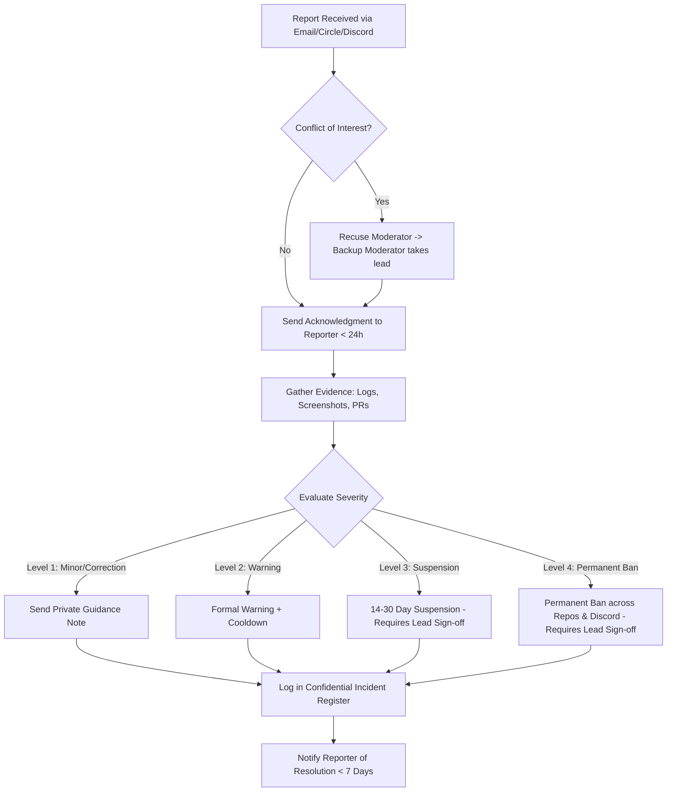

# Yazhi Community Moderation Rota & Guidelines

**Tracked in Linear:** [LEM-248](https://linear.app/yazhi-lem/issue/LEM-248) · **GitHub Issue:** [#24](https://github.com/yazhi-lem/yazhi-dev/issues/24)  
**Milestone:** Set up / October 2026 Pilot  
**Owner:** Supriya Padmashini K  
**Lead Reviewer:** Valavan Kay  

---

## 1. Purpose & Scope

The Yazhi community spans multiple public and semi-public spaces:
- **Code Repositories:** [`yazhi-lem/adhan`](https://github.com/yazhi-lem/adhan), [`yazhi-lem/open-sangam`](https://github.com/yazhi-lem/open-sangam), [`yazhi-lem/illakiya`](https://github.com/yazhi-lem/illakiya), [`yazhi-lem/yazh-unity`](https://github.com/yazhi-lem/yazh-unity), [`yazhi-lem/yazhi-dev`](https://github.com/yazhi-lem/yazhi-dev), and [`yazhi-lem/yazhi-skills`](https://github.com/yazhi-lem/yazhi-skills).
- **Community Platforms:** `circle.yazhi.dev` and Discord (`discord.gg/yazhi`).
- **Events & Working Groups:** Virtual Dev Space sessions, sprint calls, and physical hackathons/meetups.

To ensure our [Code of Conduct](../CODE_OF_CONDUCT.md) is actively and fairly upheld, moderation is governed by a **structured weekly rota**. Every slot has a dedicated **Primary Moderator** and a **Backup Moderator** to prevent burnout, eliminate single points of failure, and guarantee swift response times for community safety.

---

## 2. Core Service Level Agreements (SLAs)

All incident reports, flags, and conduct inquiries are governed by strict time commitments:

| Metric | Target SLA | Description |
|---|---|---|
| **First Acknowledgment** | **< 24 Hours** | On-duty Primary Moderator confirms receipt of the report to the reporter. |
| **Initial Assessment & Triage** | **< 48 Hours** | Conflict check completed; evidence reviewed; triage decision reached. |
| **PR First Review** | **< 48 Hours** | Every external contributor PR receives an initial human technical or editorial review. |
| **Incident Resolution** | **< 7 Calendar Days** | Final resolution communicated to affected parties and recorded in private logs. |

---

## 3. Moderator Selection & Confirmation Protocol

> **Mandatory Rule:** *Every person on the rota must be contacted directly, and their explicit written consent ("Yes, I can take this slot") must be received before their name is committed to the schedule.*

### Confirmation Checklist
1. **Advance Notice:** Reach out to nominated moderators at least **7 days** before the start of the rotation cycle.
2. **Availability Check:** Confirm timezone coverage, scheduled holidays, and exam/work commitments.
3. **Emergency Contact:** Verify preferred escalation contact channel (Discord DM, Signal, or Phone).
4. **Sign-off:** Moderator confirms acceptance of the [Code of Conduct](../CODE_OF_CONDUCT.md) and moderation confidentiality agreement.

---

## 4. Active Moderation Rota (Rolling 8-Week Schedule)

Below is the foundational rota for the **October 2026 Pilot Release** and ecosystem rollout:

| Week | Date Range | Primary Moderator | Backup Moderator | Shift Status | Coverage Focus |
|:---:|:---|:---|:---|:---:|:---|
| **W1** | Oct 06 – Oct 12, 2026 | **Supriya Padmashini K** | **Valavan Kay** | `Confirmed` | Pilot onboarding & Discord setup |
| **W2** | Oct 13 – Oct 19, 2026 | **Valavan Kay** | **Supriya Padmashini K** | `Confirmed` | Circle launch & repo index rollout |
| **W3** | Oct 20 – Oct 26, 2026 | **Karthik N** | **Supriya Padmashini K** | `Confirmed` | Sangam / Open-Sangam PR triage |
| **W4** | Oct 27 – Nov 02, 2026 | **Ananya S** | **Valavan Kay** | `Confirmed` | Adhan tokenizer & dataset questions |
| **W5** | Nov 03 – Nov 09, 2026 | **Supriya Padmashini K** | **Karthik N** | `Pending Confirmation` | Illakiya mobile keyboard testing |
| **W6** | Nov 10 – Nov 16, 2026 | **Sundaram R** | **Ananya S** | `Pending Confirmation` | Community translation & corpus sprint |
| **W7** | Nov 17 – Nov 23, 2026 | **Valavan Kay** | **Sundaram R** | `Pending Confirmation` | Dev Space session moderation |
| **W8** | Nov 24 – Nov 30, 2026 | **Karthik N** | **Supriya Padmashini K** | `Pending Confirmation` | Pre-December launch stabilization |

*(Live updates and private contact details are synchronized in the internal team drive under `/ops/moderation-rota-2026.xlsx`.)*

---

## 5. Roles & Responsibilities

### Primary Moderator (On-Duty)
- **Daily Inbox Triage:** Check `conduct@yazhi.dev`, flagged posts on `circle.yazhi.dev`, and the `#mod-help` ticket queue on Discord at least twice daily.
- **Incident Ownership:** Own incoming reports from receipt through resolution within the 24h / 48h SLAs.
- **First-Response Communication:** Send empathetic, neutral, and clear acknowledgments to reporters.
- **Shift Handover:** Conduct the weekly shift transition call or message with the incoming Primary Moderator every Sunday evening.

### Backup Moderator
- **Immediate Failover:** Step in if the Primary Moderator is unreachable for > 12 hours during an active incident.
- **Conflict of Interest Coverage:** Act as lead investigator if the Primary Moderator is named in a report, has a close working relationship with the parties, or has any other conflict.
- **Dual-Signoff for Escalations:** Review and co-sign any Level 3 (Temporary Suspension) or Level 4 (Permanent Ban) decisions before execution.

---

## 6. Incident Response & Escalation Playbook



### Step 1: Ingestion & Conflict Check
1. The on-duty moderator logs the report timestamp.
2. Verify conflicts: If the report mentions or involves any moderator or core team member, that person is immediately excluded from all threads and documents regarding the case.

### Step 2: Evidence Gathering & Fact-Finding
1. Save permanent copies (archive links, raw screenshots, exported chat logs).
2. Avoid engaging in public back-and-forth arguments. Discussions must happen privately.
3. If necessary, hear all parties separately without exposing private contact info.

### Step 3: Determining the Action
Consult the **Enforcement Ladder** in [`CODE_OF_CONDUCT.md`](../CODE_OF_CONDUCT.md):
- **Level 1 (Correction):** Clarification or private educational guidance.
- **Level 2 (Warning):** Written warning detailing future consequences.
- **Level 3 (Temporary Suspension):** Account suspension for 14–30 days. Requires concurrence between Primary, Backup, and Lead.
- **Level 4 (Permanent Ban):** Permanent ban from GitHub, Circle, Discord, and community events. Requires Lead (Valavan Kay) sign-off.

### Step 4: Confidential Logging & Handover
Record the case in the internal confidential log with:
- Case ID (e.g., `MOD-2026-001`)
- Timestamp & channel where incident occurred
- Reporter identifier (kept strictly confidential)
- Reported party identifier
- Summary of violation & evidence links
- Action taken & date resolved

---

## 7. Platform Gate Setup (LEM-209 Integration)

To satisfy the constraint **"Code of conduct in place before anyone joins"**, all community entry points must enforce explicit agreement:

### A. Discord (`discord.gg/yazhi`)
1. Enable **Community Server Settings** → **Membership Screening** (Rule Screening).
2. Insert the summary text from `CODE_OF_CONDUCT.md` ("Our Pledge & Expected Behaviour").
3. Require members to tick the agreement checkbox: *"I have read and agree to follow the Yazhi Code of Conduct."* before permissions are granted to send messages or react.

### B. Circle (`circle.yazhi.dev`)
1. Enable the **Terms & Code of Conduct acceptance modal** upon first user sign-in.
2. Link directly to `https://yazhi.dev/conduct` (or `CODE_OF_CONDUCT.md`).
3. Store the `accepted_terms_timestamp` in the user's IAM profile.

### C. GitHub Repositories
1. Ensure `.github/PULL_REQUEST_TEMPLATE.md` contains the mandatory verification checkbox:
   ```markdown
   - [ ] I have read and agree to follow the [Yazhi Code of Conduct](CODE_OF_CONDUCT.md).
   ```

---

## 8. Shift Handover Template

Every Sunday by 20:00 IST, the outgoing Primary Moderator sends this update to the incoming Primary Moderator and Backup in `#mod-ops`:

```markdown
### 📋 Moderation Handover — Week [N] to Week [N+1]
- **Outgoing Primary:** @[Name]
- **Incoming Primary:** @[Name]
- **Incoming Backup:** @[Name]
- **Open Incidents / Reports Pending:** [None / Case MOD-YYYY-XXX description]
- **High-Attention PRs or Threads:** [Links or 'None']
- **Platform Health:**
  - Discord ticket queue: [Clear / X open]
  - conduct@yazhi.dev inbox: [Clear / X open]
  - Circle flags: [Clear / X open]
- **Special Notes:** [Upcoming sprint, release, or high-traffic event]
```
